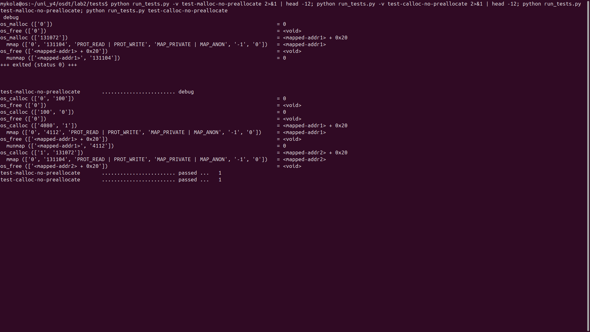
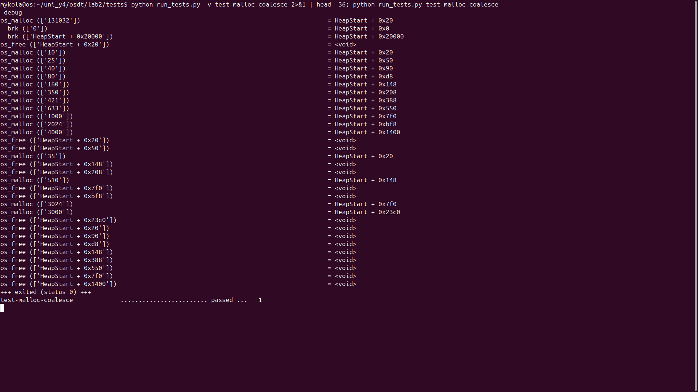
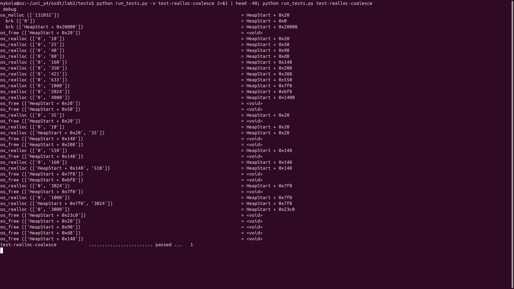

# Звіт з лабораторної роботи №2: власний алокатор пам'яті

**Дисципліна:** Операційні системи
**Тема:** реалізація `malloc()`, `calloc()`, `realloc()` та `free()` мовою C
**Завдання:** [open-education-hub/operating-systems, memory-allocator](https://github.com/open-education-hub/operating-systems/tree/main/content/assignments/memory-allocator) (локальна копія: [`TASK.md`](TASK.md))
**Код:** [`src/osmem.c`](src/osmem.c)

## 1. Мета роботи

Я хотів на практиці зрозуміти, як працює динамічна пам'ять під капотом. Для цього я написав власну мінімальну
бібліотеку `libosmem.so` з функціями `os_malloc`, `os_calloc`, `os_realloc` і `os_free`.
Вона напряму користується системними викликами Linux `brk()` (купа), `mmap()` та `munmap()` (великі блоки).
Окремо я навчився читати трасу викликів через `ltrace` і перевіряти пам'ять через `valgrind`.

## 2. Загальний результат

- Усі **40 з 40** тестів пройдено: `Total: 90/100`.
  Це максимум, який рахує скрипт `run_tests.py`: сума балів тестів дорівнює 90, а решта 10 балів у завданні відведена на стиль коду, і скрипт їх не перевіряє.
- `valgrind --leak-check=full` не виявив помилок і витоків.
- Збірка з прапорцями `-Wall -Wextra` проходить без жодного попередження.
- Виклик `mremap()` не використовується, а результат кожного системного виклику перевіряється макросом `DIE()`.

## 3. Як я це реалізував

### 3.1. Структура блока

Кожен блок починається з метаданих `struct block_meta` (поля `size`, `status`, `prev`, `next`), за якими йде корисне
навантаження (payload). Користувачеві повертається адреса payload, а не метаданих.
Структура займає 32 байти (`0x20`), а розмір кожного блока я округлюю вгору до 8 байтів, тому всі адреси вирівняні по 8.

Блоки, що лежать у купі, я зберігаю в двозв'язному списку, впорядкованому за адресою. Саме така впорядкованість
дозволяє швидко знаходити сусідів для злиття і визначати, що блок останній. Блоки, виділені через `mmap`, у список
не потрапляють: вони існують окремо, і для них достатньо `munmap` при звільненні.

### 3.2. `os_malloc`

1. Розмір `0` повертає `NULL`.
2. Розмір округлюється до 8 байтів.
3. Якщо `розмір + метадані >= 128 KiB`, блок виділяється через `mmap` (статус `STATUS_MAPPED`).
4. Інакше блок береться з купи (`STATUS_ALLOC`). Якщо купа ще не використовувалась, я **один раз** виділяю одразу 128 KiB
   (preallocation), щоб скоротити кількість майбутніх викликів `brk`.

### 3.3. Алгоритм вибору блока в купі

1. **Коалесценція.** Я зливаю всі сусідні вільні блоки в один, щоб боротися із зовнішньою фрагментацією.
2. **Find best.** Я проходжу весь список і беру вільний блок найменшого розміру, якого ще вистачає.
3. **Split.** Якщо залишок блока вміщує нові метадані та хоча б 8 байтів даних, я відрізаю його у новий вільний блок.
   Так зменшується внутрішня фрагментація. Якщо залишок менший, блок віддається цілим.
4. Якщо підходящого блока немає, а останній блок вільний, я розширюю саме його через `brk` рівно на потрібну різницю.
   Якщо останній блок зайнятий, я додаю в кінець новий блок.

### 3.4. `os_calloc`

Працює так само, як `malloc`, але з двома відмінностями. Поріг переходу на `mmap` тут дорівнює розміру сторінки
(`getpagesize()`, 4096 байтів), а не 128 KiB. Пам'ять після виділення занулюється через `memset`.
Також я додав перевірку переповнення при множенні `nmemb * size` (`__builtin_mul_overflow`), щоб `calloc` не повертав
менший блок, ніж просили.

### 3.5. `os_realloc`

- `ptr == NULL` дорівнює `os_malloc(size)`; `size == 0` дорівнює `os_free(ptr)`.
- Якщо блок уже вільний, повертається `NULL`. Це захист від неправильного використання, який вимагає завдання.
- Блок з `mmap`, а також випадок, коли новий розмір сягає порога `mmap`, обробляються так: виділити новий блок,
  скопіювати `min(старий, новий)` байтів, звільнити старий.
- Зменшення розміру відбувається на місці з відрізанням залишку (split).
- Збільшення розміру: спочатку я **по черзі** зливаю блок зі сусідніми вільними блоками і після кожного злиття
  перевіряю, чи вистачає місця (злиті блоки залишаються злитими, навіть якщо розміру все одно не вистачило).
  Якщо блок виявився останнім у купі, я просто розширюю купу. В іншому випадку переношу дані в новий блок.

### 3.6. `os_free`

Для `mmap`-блока викликається `munmap`. Для блока в купі пам'ять в ОС **не повертається**: я лише позначаю його
`STATUS_FREE`, щоб використати повторно (злиття відбувається пізніше, перед наступним пошуком блока).

## 4. Тестування: скріншоти виконання

Усі знімки зроблені на моїй машині (Ubuntu 24.04, gcc 13.3, ltrace 0.7.3, valgrind 3.22.0) і показують справжній
вивід у терміналі на весь екран. Тести запускаються командою `make check` у каталозі `tests/`.

### 4.1. Збірка бібліотеки та тестових програм

Збираються `libosmem.so` і всі тестові програми зі `snippets/`. Попереджень компілятора немає.


### 4.2. Запуск усіх тестів (`make check`)

Усі 40 тестів мають статус `passed`, підсумок `Total: 90/100`. Скрипт для кожного тесту ще й перевіряє витоки
пам'яті через `valgrind`, і жоден тест через це не впав.


### 4.3. Перевірка `valgrind` та траса окремого тесту

Для `test-all` `valgrind` повідомляє `0 errors from 0 contexts` та `no leaks are possible`.
Нижче видно трасу `test-realloc-expand-block`: послідовні виклики `os_realloc` розширюють блок на місці, тому адреса
`HeapStart + 0x20020` не змінюється, а `brk` збільшує купу лише на потрібну різницю.


### 4.4. Великі блоки через `mmap` і відсутність преалокації

- `os_malloc(131072)` (разом з метаданими понад 128 KiB) викликає `mmap` на 131104 байти (131072 плюс 32 байти метаданих), а
  `os_free` викликає `munmap` з тим самим розміром.
- `os_calloc(4080, 1)` разом з метаданими дає 4112 байтів, що перевищує розмір сторінки, тому `calloc` теж іде через `mmap`,
  хоча `malloc` для такого розміру використав би купу.
- `os_malloc(0)`, `os_calloc(0, 100)`, `os_calloc(100, 0)` повертають `NULL`, а `os_free(NULL)` нічого не робить.
- Купа при цьому не преалокується (немає жодного `brk`), бо preallocation потрібна лише при першому зверненні до купи.



### 4.5. Преалокація, split і коалесценція (`test-malloc-coalesce`)

- Перший `os_malloc(131032)` викликає `brk(0)` і `brk(HeapStart + 0x20000)`: це та сама одноразова преалокація 128 KiB.
  Після його звільнення подальші малі виділення (`10`, `25`, `40`, …) **розрізають** цей блок (split): адреси `0x20`, `0x50`, `0x90`, `0xd8`, …
  ідуть послідовно, а нових `brk` немає.
- Після `os_free` двох сусідніх блоків (`0x20` і `0x50`) наступний `os_malloc(35)` отримує адресу `0x20`: блоки були злиті
  (coalesce), і результат потрапив у найкращий підходящий блок.
- Те саме з парою `0x148` та `0x208`: `os_malloc(510)` займає `0x148`. Аналогічно `0x7f0` і `0xbf8` для `os_malloc(3024)`.



### 4.6. `os_realloc` із коалесценцією (`test-realloc-coalesce`)

Спочатку блок виділяється малим розміром, поряд звільняються сусіди, а потім `os_realloc(ptr, 35)` та `os_realloc(ptr, 510)`
повертають **ту саму адресу** (`0x20` і `0x148`). Тобто блок розширився за рахунок злиття з вільними сусідами,
а не переїхав на нове місце, як цього й вимагає завдання.



## 5. Труднощі та висновки

- **Збіг із еталонною трасою до байта.** Перевірка порівнює не лише результат, а й адреси та виклики `brk`/`mmap`. Тому важливо було точно
  дотримуватися правил: поріг `mmap` береться разом з метаданими, split вимагає місця під метадані плюс щонайменше 8 байтів,
  а купа розширюється лише у разі нестачі місця й лише останнім блоком.
- **Коректність `realloc`.** Найтонший момент: злиття із сусідами треба робити по одному й перевіряти розмір після кожного кроку,
  а блок, який став останнім, достатньо розширити через `brk`, а не переносити.
- **Інструменти.** Для запуску тестів потрібні `ltrace` і `valgrind`. На моїй машині їх не було, а прав `sudo` я не мав, тому
  розпакував їхні `.deb`-пакети у тимчасову теку й додав її в `PATH`. Сам код проєкту від цього не змінювався.

У результаті я отримав працюючий алокатор, який проходить усі тести та перевірку витоків, і набув практичного розуміння того, як
`malloc` керує купою, чому великі виділення йдуть через `mmap` та як фрагментацію зменшують злиття й розрізання блоків.

## 6. Як відтворити

```console
cd tests/
make check
```

Потрібні `gcc`, `make`, `python`, `ltrace` та `valgrind`.
