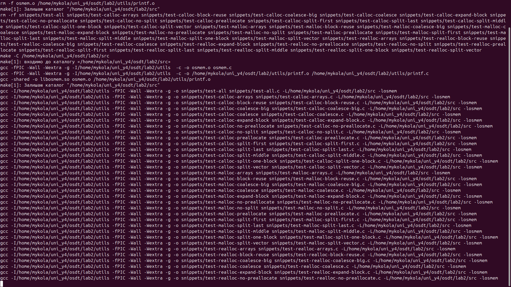
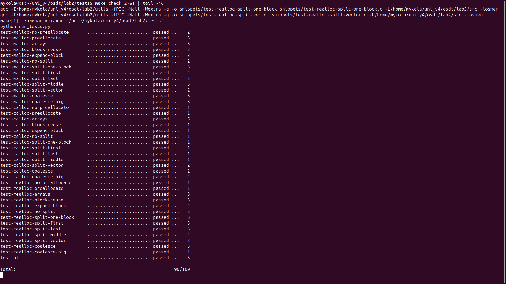
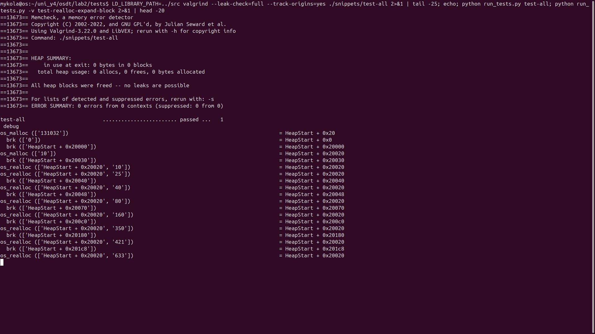

# Звіт: Memory Allocator (ОС, лабораторна 2)

Власна реалізація `os_malloc()`, `os_calloc()`, `os_realloc()` та `os_free()` мовою C
за завданням [open-education-hub/operating-systems → memory-allocator](https://github.com/open-education-hub/operating-systems/tree/main/content/assignments/memory-allocator).
Рішення знаходиться у [`src/osmem.c`](src/osmem.c).

## Результат

Усі 40 тестів проходять разом із перевіркою витоків пам'яті (`valgrind`): **90/90** балів за функціональні тести
(скрипт друкує це як `90/100`, решта 10 балів у завданні відводиться на стиль коду, його скрипт не перевіряє).

## Реалізація

| Елемент | Як зроблено |
|---|---|
| Метадані | `struct block_meta` (32 байти) на початку кожного блоку; адреса, що повертається, вказує на payload. Розміри й payload вирівняні по 8 байтів |
| Список блоків | двозв'язний список блоків у купі, впорядкований за адресою; `mmap`-блоки в списку не зберігаються |
| `malloc` | розмір разом з метаданими `< 128 KiB` → купа (`brk`/`sbrk`), інакше `mmap` |
| `calloc` | те саме, але поріг для `mmap` — розмір сторінки (`getpagesize()`); пам'ять занулюється; є перевірка переповнення `nmemb * size` |
| Preallocation | при першому використанні купи один раз виділяється 128 KiB і далі розрізається |
| Пошук блока | спочатку коалесценція всіх сусідніх вільних блоків, потім **find best** (найменший вільний блок, що підходить) |
| Split | залишок відрізається у новий вільний блок, якщо в ньому вміщуються метадані та щонайменше 8 байтів payload |
| Збільшення купи | якщо вільного блока немає: розширюється останній блок, коли він вільний, інакше додається новий |
| `free` | `mmap`-блок → `munmap`; блок у купі лише позначається `STATUS_FREE` (купа ОС не повертається) |
| `realloc` | `NULL` → `malloc`; розмір `0` → `free`; вільний блок → `NULL`; зменшення → split на місці; збільшення → по черзі зливається зі вільними сусідами, потім розширення останнього блока, інакше переміщення (malloc + memcpy + free); для `mmap`-блоків завжди переміщення |
| Помилки сисвикликів | усі `sbrk`/`mmap`/`munmap` перевіряються через `DIE()` |

`mremap()` не використовується.

## Скріншоти запуску тестів

Знімки зроблено на моїй машині (Ubuntu 24.04, gcc 13.3, ltrace 0.7.3, valgrind 3.22.0), екран термінала на весь розмір.

### 1. Збірка `libosmem.so` та тестових бінарників (без попереджень)



### 2. `make check`: усі тести пройдені, `Total: 90/100`



### 3. `valgrind` на `test-all` (без помилок і витоків) та запуск окремого тесту з трасою системних викликів



## Як відтворити

```console
cd tests/
make check
```

Для запуску потрібні `gcc`, `make`, `python`, `ltrace` та `valgrind`.
